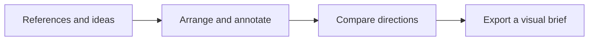

# Kenny Canvas
### Turn scattered references into a shared visual direction.

A browser-based visual workspace for founders, product teams and designers. Bring images, video, notes and text onto one infinite canvas, arrange a direction, then export a PNG or PDF for discussion.

**[Open Kenny Canvas](https://kennylimkamho.github.io/kenny-canvas/)**

**Status: working prototype.** Built with React and Konva. Designed for a single-person session; export your work before closing the tab. Media is not restored after reload and this version does not offer durable board storage or multiplayer collaboration.

## Why it exists

Product conversations often start with scattered screenshots and disconnected notes. Kenny Canvas makes those references spatial: put alternatives side by side, annotate the tradeoffs and share one visual brief.



## A first session

1. Run the app using the commands below.
2. Drop images or videos onto the board, then add sticky notes or text.
3. Move and resize objects; use selection and duplication to organize the board.
4. Export as PNG or PDF to keep and share the result. Video exports are static frames.

## What works today

| Capability | What you can do |
| --- | --- |
| Mixed media | Arrange image and video references alongside notes and text |
| Navigation | Pan, zoom and fit the board to your view |
| Editing | Select, move, resize and duplicate items |
| Layout | Toggle a grid as a visual layout guide |
| Output | Export a PNG or PDF at the available scale options |

**Example use:** compare three onboarding directions, annotate the friction in each, and export the board as a product brief. This is an illustrative workflow, not a customer result.

## Run locally

Requires Node.js 20+ and npm.

```sh
npm ci
npm run dev
```

Production build: `npm run build`. Preview it with `npm run preview`.

## Product decisions

- **A spatial workspace:** relationships and tradeoffs remain visible while you think.
- **Mixed media:** a product brief needs references as well as words.
- **Exportable output:** the session should produce something a teammate can review.
- **A focused prototype:** the current code tests the canvas interaction; durable storage, robust media recovery and collaboration are future work.

## Under the hood

React manages interaction state; Konva renders and transforms the canvas; jsPDF produces PDF output. The current editor lives in `src/App.jsx`. There is no application backend in this repository.

## About the builder

Kenny is a product-led founder building with AI-assisted development. This project connects product framing, interaction design and implementation. Explore [Kenny’s portfolio](https://github.com/kennylimkamho) and [the design systems](https://github.com/kennylimkamho/design-system).
